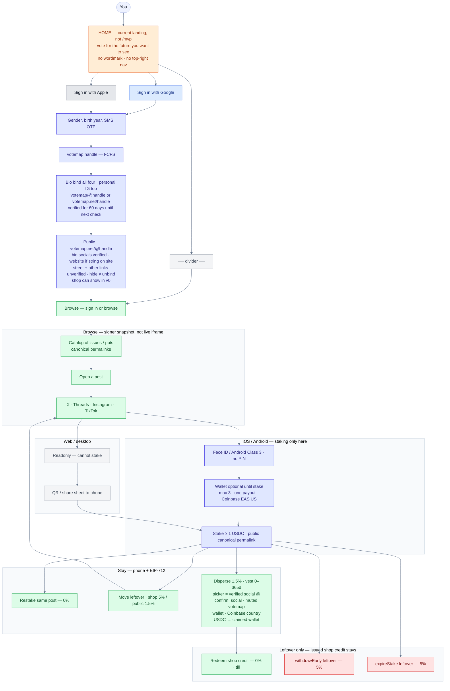
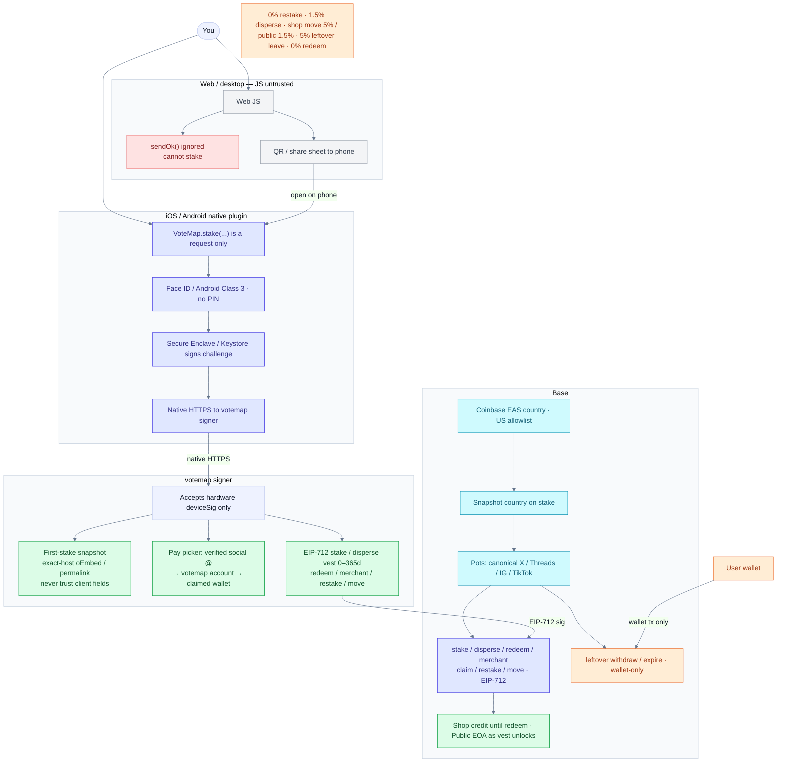
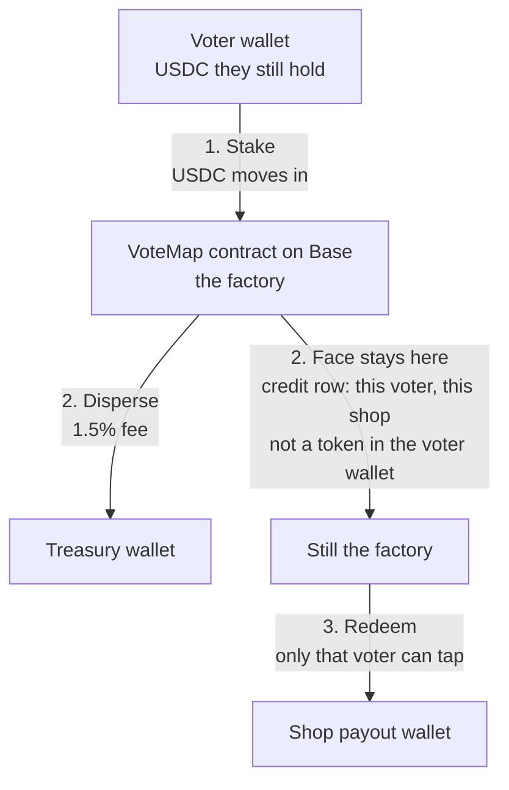

# votemap v0 flows

Checked against [requirements](./requirements.md) — **v0 only**. Later (not solved, unfinished): [later.md](./later.md). Open questions: [open.md](./open.md). Home is the **current landing** (*vote for the future you want to see*), not a `/mvp` clone.

- User flow diagram: the PNG is not in this repo. The mermaid under section 1 is the text.
- System flow diagram: the PNG is not in this repo. The mermaid under section 2 is the text.
- [shop credit](#where-shop-usdc-sits)

**Fees:** **0% restake · 1.5% disperse · shop move 5% / public move 1.5% · 5% leftover leave · 0% redeem**. Shop = credit spent on a listed product. Public = EOA. **Pay picker** = verified social @ → confirm → **claimed wallet**.

## 1. User flow

**Sign in:** Google or Apple (OIDC) → gender, birth year, SMS OTP → unique votemap handle (**FCFS**) + unique E.164.

**Bio bind (v0, all four, personal IG too):** put **`votemap/@handle` or `votemap.net/handle`** in that account’s **bio**. **No comment on `@vote_map`. No other fallback.** **No social OAuth, no cold-DM, no paid X API.** One social @ → one votemap account. Cards / pay UI: **verified social @ primary**, votemap handle **muted**. No bind → votemap handle only (not fake-verified) and **cannot be paid**.

**Public page (v0):** `votemap.net/@handle`. Linktree-like. They customize which links show (labels, order, listed). Verified marks in v0 are only TikTok, X, Threads, and Instagram, via the bio rule (`votemap/@handle` or `votemap.net/handle` in that account bio, 60 days, daily job on due binds only), and a website only if that site itself shows `votemap/@handle` or `votemap.net/handle` (same two strings, same 60-day window, same daily job: re-check when due, string still there → another 60 days, gone → lapses; do not fetch early; do not verify every URL). A street address and any other link stay unverified. Showing the website on the public page is optional. Hiding it does not unbind it. **Shop is a catalog**, not only an address: they list products they sell (name, USDC price, physical or not, short text; off-chain, like links; not a token). Not shipping labels, tax, themes, inventory sync, or staff accounts. License stays later. Hiding a social does **not** unbind it. Pay picker still uses the bio bind. Bio text stays `votemap/@handle` or `votemap.net/handle`.

**Shop register:** Coinbase US + `registerMerchant`. Address and/or website required. Street shown **unverified**. Website verified only as stated above. Verified social is the bio bind. Does not prove they control the street. A shop cannot receive a bounty (shop disperse / redeem) unless it has at least one verified link and zero unverified links. An address-only shop or any unverified link cannot. A street address is not a link and does not by itself disqualify a shop. The public payee picker is unchanged. Products live on the public page (item 6).

**Browse:** signer snapshot at first stake (canonical permalink; exact-host allowlist; never trust client handle/text/date). A post that is private, deleted, or not embeddable **at stake time** does not get through. **No pot.** Live embed is iframe-opaque — filters never read it. After money is in, private/deleted is [open](./open.md).

**Web/desktop:** readonly + QR / share sheet. **Stake only on iOS/Android** after Face ID / Class 3 (no PIN). Wallet optional until stake; **max 3**, one payout. Coinbase Onchain Verify **EAS US** on the signing wallet. Paste a public canonical permalink (X / Threads / IG / TikTok).

**Pay:** pick **verified social @** (not votemap @) → reverse lookup votemap account → **confirm** (social @, muted votemap @, wallet, Coinbase country) → USDC to **claimed wallet**. Unbound / unverified social cannot be a dest.

**Where the money went (v0):** the signer already handles stake / disperse / move / redeem. On that path it appends **one row:** action (`stake` / `disperse` / `move` / `redeem`), from votemap handle, to votemap handle, amount, pot, tx hash. Handles are the names at that moment. The page lists those rows and **shows the action label**. Hash links **Basescan**. No-account hop is **unknown hands** (address, never a fake name). **Score** on that list, visible only: share of these rows whose wallets are votemap accounts. No fee discount / rank prize / new fee. Off-platform hops are **not** in this score (general explorer, later). Bound IG / X / Threads / TikTok from the pay lookup. Reads **`@isaac` paid `@grok`**. No archive node, no general USDC indexer. No privacy hide.

On a live line: **restake** leftover 0%, **move** leftover (shop **5%**, public **1.5%**), or **disperse** slices before expiry (`$50 A` day 1, `$25 B` day 2) with **vest 0–365 days**. Shop = vested credit on a listed product at that shop. Public = wallet as it unlocks.

“Stake” means a votemap pot stake: USDC moved into the VoteMap contract against a public post. It is not DeFi / yield / validator staking. No interest. While it is a pot stake, it sits until that pot’s expiry, or until disperse / move / early exit under the existing fee rules. While it is shop credit (after disperse), there is no expiry clock in v0. It sits in the factory until that voter redeems. Redeem is final.

Solved v0: Redeem is final. Once the voter taps redeem, the shop credit USDC leaves the VoteMap factory and is paid to that merchant’s payout wallet. No VoteMap refund, no chargeback, no second hold, no two-step escrow after redeem. Redeem is the purchase, and it is final.

User flow diagram PNG is not in this repo.

**UI:** bound social @ is the **name**; votemap handle muted. Public page: shop is a **catalog**. Verified marks are bio-bound socials and a website that shows the string; street and other links stay unverified.

## 2. System

Web JS is untrusted: `sendOk()` is ignored. Native plugin does Face ID / Class 3, signs with Secure Enclave / Keystore, HTTPS to the votemap signer. Signer EIP-712-signs stake / pay / redeem / registerMerchant / claim / restake / move, **snapshots the post** from exact-host allowlisted oEmbed/permalink hosts, **looks up** verified social @ → votemap account → claimed wallet, and on stake / disperse / move / redeem **appends one trail row** (action: stake / disperse / move / redeem; from handle, to handle, amount, pot, tx hash; no-account hop is **unknown hands**). Never trust client handle/text/date. Official embeds are **cross-origin iframes after hydrate**. Leftover `withdrawEarly` / `expireStake` are wallet-only. Shop credit is not.

System flow diagram PNG is not in this repo.

## Where shop USDC sits

The factory is the **VoteMap contract**, one address on **Base**. It is not a votemap bank account, and Base does not custody the tokens.

1. **Stake.** USDC leaves the voter wallet and sits in the VoteMap contract.
2. **Disperse to a shop.** The 1.5% fee leaves for the treasury. The rest stays in the contract as a credit row: this voter, this shop. The shop’s wallet does not have it. The voter cannot send it, because it is no longer in their wallet.
3. **Redeem.** Solved v0: Redeem is final. Once the voter taps redeem, the shop credit USDC leaves the VoteMap factory and is paid to that merchant’s payout wallet. No VoteMap refund, no chargeback, no second hold, no two-step escrow after redeem. Redeem is the purchase, and it is final. No other shop. The shop cannot pull.

“Stake” means a votemap pot stake: USDC moved into the VoteMap contract against a public post. It is not DeFi / yield / validator staking. No interest. While it is a pot stake, it sits until that pot’s expiry, or until disperse / move / early exit under the existing fee rules. While it is shop credit (after disperse), there is no expiry clock in v0. It sits in the factory until that voter redeems. Redeem is final.

USDC still sitting in the voter’s wallet is theirs. This diagram is only the amount that was staked and then dispersed.

Shop-credit diagram PNG is not in this repo.
