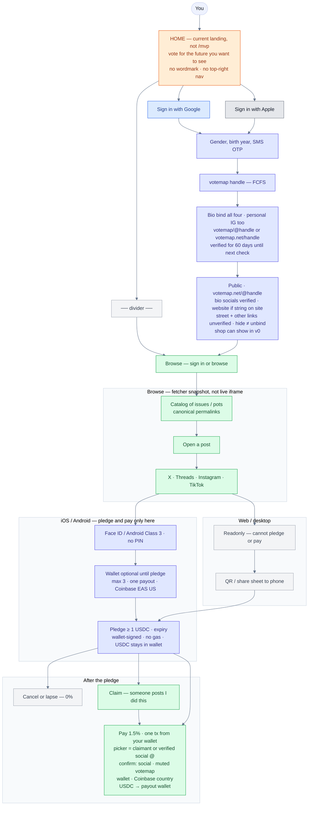
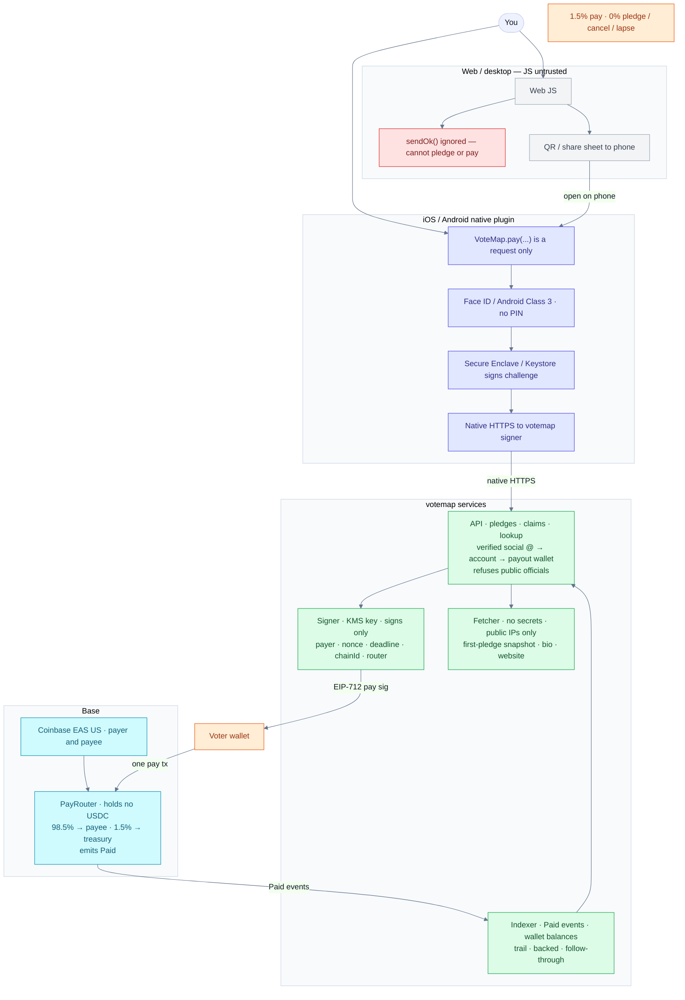
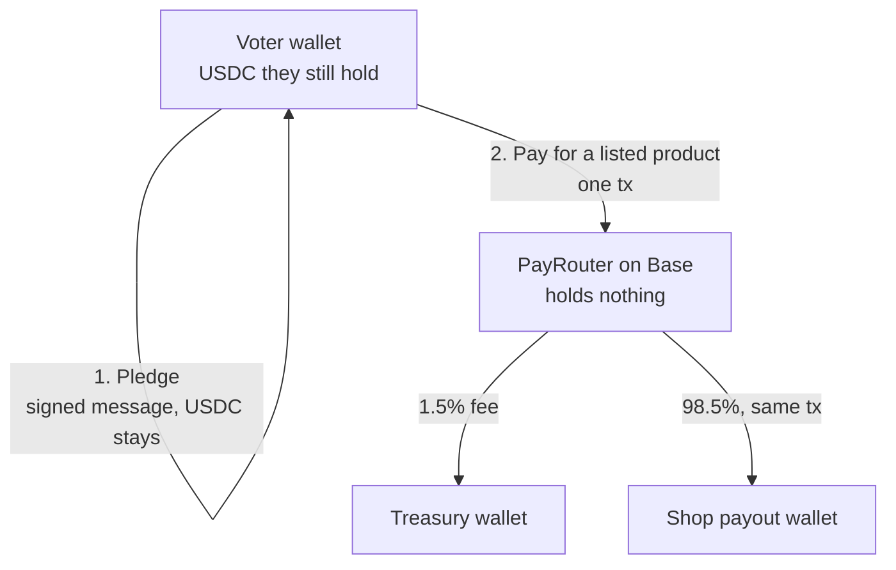

# votemap v0 flows

Checked against [requirements](./requirements.md) — **v0 only**. Later (not solved, unfinished): [later.md](./later.md). Open questions: [open.md](./open.md). Home is the **current landing** (*vote for the future you want to see*), not a `/mvp` clone.

- User flow diagram: the PNG is not in this repo. The mermaid under section 1 is the text.
- System flow diagram: the PNG is not in this repo. The mermaid under section 2 is the text.
- [where shop USDC goes](#where-shop-usdc-goes)

**No custody.** VoteMap never holds USDC. **Fees:** **1.5% on pay · 0% pledge, cancel, lapse**. A pledge is a wallet-signed promise (no gas, no USDC moves). A pay goes from the voter’s wallet straight to the payee’s wallet in one transaction. **Pay picker** = verified social @ → confirm → **payout wallet**. Public officials cannot be paid ([requirements](./requirements.md) item 27).

## 1. User flow

**Sign in:** Google or Apple (OIDC) → gender, birth year, SMS OTP → unique votemap handle (**FCFS**) + unique E.164.

**Bio bind (v0, all four, personal IG too):** put **`votemap/@handle` or `votemap.net/handle`** in that account’s **bio**. **No comment on `@vote_map`. No other fallback.** **No social OAuth, no cold-DM, no paid X API.** One social @ → one votemap account. Cards / pay UI: **verified social @ primary**, votemap handle **muted**. No bind → votemap handle only (not fake-verified) and **cannot be paid**.

**Public page (v0):** `votemap.net/@handle`. Linktree-like. They customize which links show (labels, order, listed). Verified marks in v0 are only TikTok, X, Threads, and Instagram, via the bio rule (`votemap/@handle` or `votemap.net/handle` in that account bio, 60 days, daily job on due binds only), and a website only if that site itself shows `votemap/@handle` or `votemap.net/handle` (same two strings, same 60-day window, same daily job: re-check when due, string still there → another 60 days, gone → lapses; do not fetch early; do not verify every URL). A street address and any other link stay unverified. Showing the website on the public page is optional. Hiding it does not unbind it. **Shop is a catalog**, not only an address: they list products they sell (name, USDC price, physical or not, short text; off-chain, like links; not a token). Not shipping labels, tax, themes, inventory sync, or staff accounts. License stays later. Hiding a social does **not** unbind it. Pay picker still uses the bio bind. Bio text stays `votemap/@handle` or `votemap.net/handle`.

**Shop register:** Coinbase US on the payout wallet + merchant flag (off-chain). Address and/or website required. Street shown **unverified**. Website verified only as stated above. Verified social is the bio bind. Does not prove they control the street. A shop cannot be paid as a shop unless it has at least one verified link and zero unverified links. An address-only shop or any unverified link cannot. A street address is not a link and does not by itself disqualify a shop. The public payee picker is unchanged. Products live on the public page (item 6).

**Browse:** fetcher snapshot at first pledge (canonical permalink; exact-host allowlist; never trust client handle/text/date). A post that is private, deleted, or not embeddable **at first pledge** does not get through. **No pot.** Live embed is iframe-opaque — filters never read it. After pledges are in, private/deleted is [open](./open.md). Browse sorts on **backed** USDC, not pledged.

**Web/desktop:** readonly + QR / share sheet. **Pledge and pay only on iOS/Android** after Face ID / Class 3 (no PIN). Wallet optional until pledge; **max 3**, one payout. Coinbase Onchain Verify **EAS US** on the paying wallet and on the payee wallet. Paste a public canonical permalink (X / Threads / IG / TikTok).

**Pledge:** pick a post → amount (≥ 1 USDC) and expiry → wallet signs → published with **backed** amount (up to what the wallet holds). Cancel anytime, free. Lapses at expiry.

**Claim:** a verified-bind account posts “I did this” on a pot, with a link.

**Pay:** pick a claimant or a **verified social @** (not votemap @) → reverse lookup votemap account → **confirm** (social @, muted votemap @, wallet, Coinbase country) → one transaction from the voter’s wallet: 98.5% to the **payout wallet**, 1.5% to the treasury. Unbound / unverified social cannot be a dest. Pays count toward the voter’s **follow-through**.

**Where the money went (v0):** rows are **pledge** / **cancel** (from the stored signed messages) and **pay** (from the router’s `Paid` events, only once on Base): action, from votemap handle, to votemap handle, amount, pot, tx hash. Handles are the names at that moment. The page lists those rows and **shows the action label**. Hash links **Basescan**. No-account hop is **unknown hands** (address, never a fake name). No trail score. Off-platform hops are not shown (general explorer, later). Bound IG / X / Threads / TikTok from the pay lookup. Reads **`@isaac` paid `@grok`**. No archive node, no general USDC indexer. No privacy hide.

Pay is final. VoteMap cannot refund, reverse, or freeze a pay, because VoteMap never held it.

User flow diagram PNG is not in this repo.

**UI:** bound social @ is the **name**; votemap handle muted. Public page: shop is a **catalog**. Verified marks are bio-bound socials and a website that shows the string; street and other links stay unverified.

## 2. System

Web JS is untrusted: `sendOk()` is ignored. Native plugin does Face ID / Class 3, signs with Secure Enclave / Keystore, HTTPS to the votemap API. The **API** stores wallet-signed pledges and claims and **looks up** verified social @ → votemap account → payout wallet, refusing listed public officials. The **signer** (key in KMS, no outbound fetches) EIP-712-signs each pay with payer, nonce, deadline, chainId and router. The **fetcher** (no secrets, public addresses only) **snapshots the post** from exact-host allowlisted oEmbed/permalink hosts and reads bios and websites. The **indexer** reads the router’s `Paid` events and pledgers’ USDC balances for trail rows (no-account hop is **unknown hands**), backed amounts, and follow-through. Never trust client handle/text/date. Official embeds are **cross-origin iframes after hydrate**. The PayRouter holds no USDC, so there is nothing to withdraw or freeze.

System flow diagram PNG is not in this repo.

## Where shop USDC goes

VoteMap never holds it. There is no factory, no credit row, and no redeem step.

1. **Pledge.** The voter signs a promise toward the post’s outcome. USDC stays in the voter’s wallet.
2. **Pay the shop.** When the voter buys a listed product, one transaction from the voter’s wallet pays the shop’s payout wallet and the 1.5% fee. The signed pay names the product and price. The shop can show the confirmed tx at the till.

Pay is final. VoteMap cannot refund, reverse, or freeze it, because VoteMap never held it.

Shop pay diagram PNG is not in this repo.
